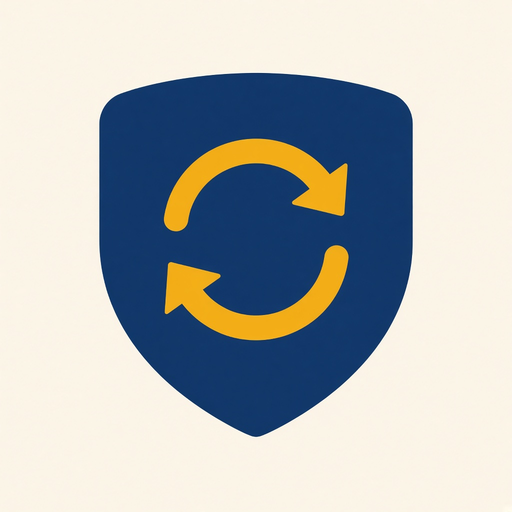
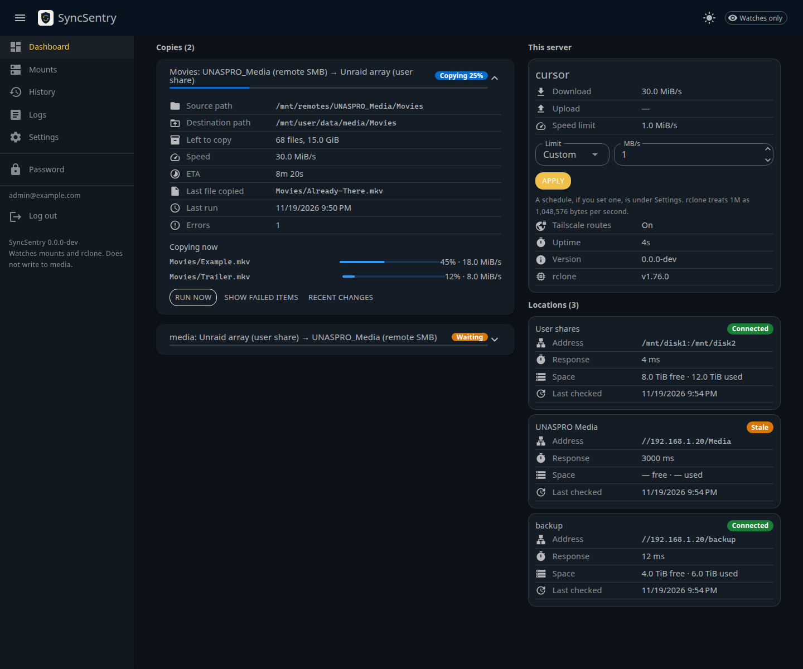
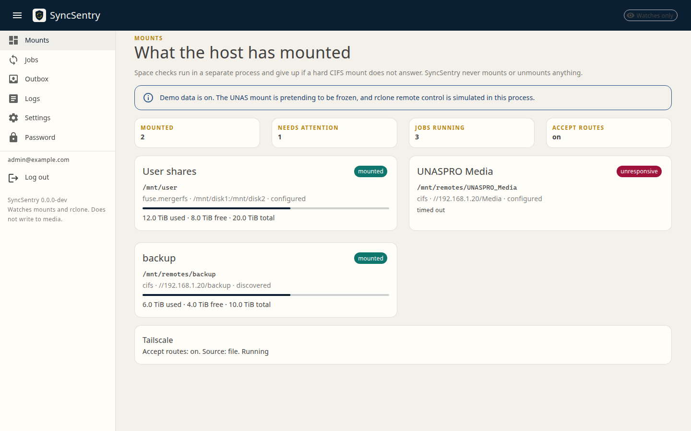
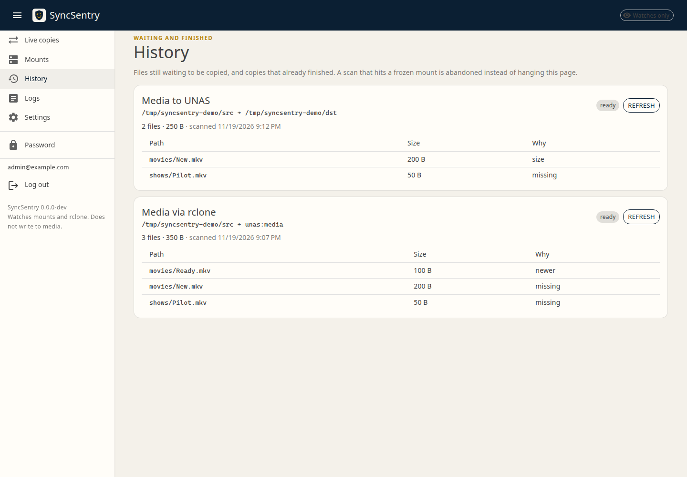
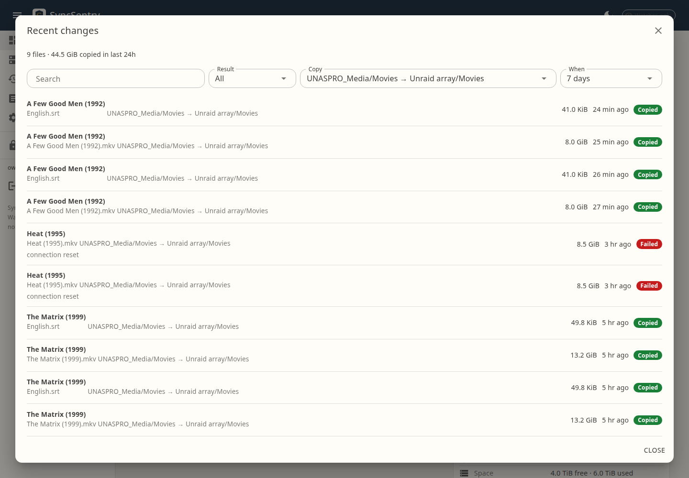
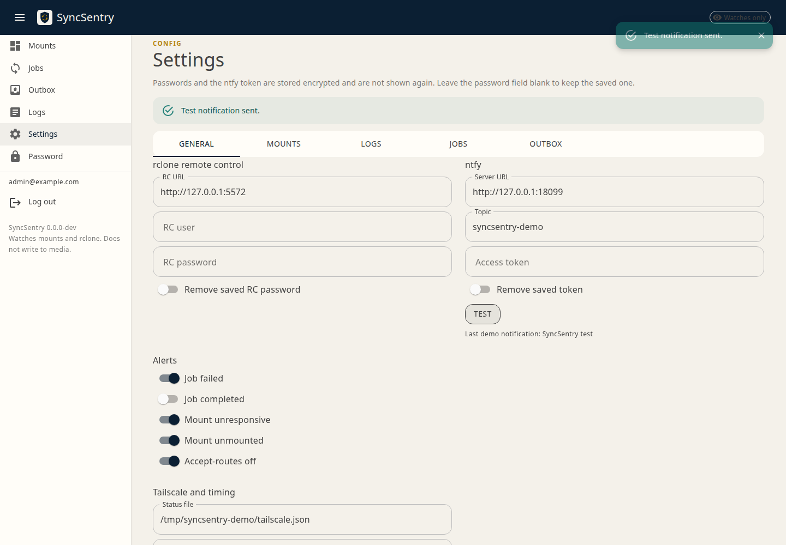

# SyncSentry

SyncSentry is a single Docker container that watches rclone copy and sync jobs, mergerfs pools, and SMB/CIFS mounts on an Unraid server. The web UI shows mount health, job progress, files still waiting to copy, and the tail of rclone's logs. Alerts go to a self-hosted [ntfy](https://ntfy.sh) server.

It does not mount or unmount anything, and it does not write to media. mergerfs and CIFS stay under the host's control.



## What you see

- **Dashboard.** The home page, laid out like the Syncthing web UI. The left column is one card per copy (source folder to destination folder), with a colored status (Up to date, Copying, Waiting, Error, Unknown) and a thin progress bar. Open a card for the paths, what is left, speed, ETA, the last file, and the files moving right now. Finished copies stay on the page with the last time they ran. The right column is this server (download and upload rate, the speed limit, Tailscale accept-routes, uptime, versions) and one card per location (connected, stale, or disconnected, with free space).
- **Mounts.** The same locations in more detail: mergerfs pools and SMB/CIFS remotes, including a path such as `/mnt/remotes/UNASPRO_Media`. Each row is mounted, unmounted, or unresponsive, with filesystem type, source, and free space when the check returns.
- **History.** Completed copies for the last 30 days: the folder, the file, where it went, the size, and whether it copied or failed. Syncthing markers, `.partial` files, and rclone temp files are hidden. **Waiting to copy** is the separate list of files still only on the source.
- **Logs.** Tail, search, and level filter for the log files you configure.
- **Customizations.** A read-only list of notes about changes on your Unraid servers, from a JSON file you mount in. The beta template maps `/mnt/cache/appdata/mediamanny/customizations` to `/customizations` and reads `/customizations/unraid-customizations.json` (`SyncSentry__Customizations__Path`).
- **Run now.** Starts one saved job. It will not start a second copy of a job that is already running.
- **Alerts.** Job failed, job completed, mount unresponsive, mount unmounted, Tailscale accept-routes off. Each one can be turned off. A test button sends one notification.

The first account you create is the admin. Sign-up closes after that.

## #unraid

Unraid 7.4, rclone installed by the Waseh plugin at `/usr/sbin/rclone`, appdata on `/mnt/cache/appdata` (the template still uses `/mnt/user/appdata/syncsentry`, which is the usual share path). A custom Docker network is fine. An existing copy logs to `/mnt/cache/appdata/mediamanny/logs/initial-copy.log` with INFO and a 60-second one-line stat.

### 1. Install the container

The draft template is [`unraid/syncsentry.xml`](unraid/syncsentry.xml). Copy it into your Community Applications templates repo when you are ready. This repository does not open that pull request.

Until then you can add the container from the Docker page:

- Repository: `ghcr.io/007darkmatter5/syncsentry:latest`
- Network: bridge, or your custom network
- Privileged: off
- Web UI port: `8080`
- Appdata: `/mnt/user/appdata/syncsentry` → `/config`
- `/mnt/user` → `/mnt/user`, read only, propagation **rslave**
- `/mnt/remotes` → `/mnt/remotes`, read only, propagation **rslave**
- `/mnt/cache/appdata/mediamanny/logs` → `/logs/mediamanny`, read only
- `PUID` `99`, `PGID` `100`, `TZ` your zone

`rslave` matters. Without it, mergerfs and CIFS mounts that appear on the host after the container starts are invisible inside the container, and a mount that disappears stays looking mounted.

If the template's propagation attribute is ignored by your Unraid build, open the path in the Docker UI and set **Read only** and **rslave** there. Do not add extra capabilities. Do not mount the Docker socket.

Open `http://<unraid>:8080/`. The first visit opens a setup wizard. It asks for the admin account, checks that `/mnt/user` and `/mnt/remotes` are mounted read-only, and then shows the rclone flags and the host helper script for you to paste. You pick the copy pairs the dashboard should follow, and you can turn on ntfy and a speed limit. Nothing in the wizard edits the Unraid host. It saves settings in appdata and then checks that the helper file showed up.

An install that already has an admin account is not sent through the wizard. On upgrade, SyncSentry marks the steps it can already see (rclone login, helper status file, saved copies) and leaves every saved setting as it was. The dashboard shows a banner only when a required folder is missing or not read-only, or when a check you still need is failing. Settings has a setup checklist with a Re-run link for each step.

### 2. Mount checks

SyncSentry reads `/proc/self/mountinfo` inside the container. That file never blocks, so a frozen mount cannot hang the page while SyncSentry is only listing what is mounted.

Free space is different. `stat` on a hard CIFS mount blocks in the kernel until the server answers, and the thread cannot be cancelled. SyncSentry runs that stat in a child process and waits a few seconds (Settings, default 3). If the child does not return, the mount is **unresponsive** and SyncSentry does not start a second check for that path. One stuck helper can remain until the mount recovers. That is one process per frozen path, not a stuck web UI. `docker stop` may wait out its stop timeout if a helper is stuck in the kernel; the web app itself keeps answering `/healthz`.

A watched path counts as mounted only when mountinfo lists that exact path. A folder left behind on a local disk after CIFS unmounts is **unmounted**, not a healthy share. mergerfs (`fuse.mergerfs`) and CIFS mounts are also picked up automatically.

The seeded watches are `/mnt/user` and `/mnt/remotes/UNASPRO_Media`. Change them under Settings if your paths differ. CIFS options such as passwords are not stored or shown.

### 3. Tailscale accept-routes

The UNAS in this setup is reached through a Tailscale subnet route (`192.168.1.0/24`). SyncSentry does not join your tailnet and does not get a privileged socket by default.

The host script in the next step writes `/mnt/user/appdata/syncsentry/host/tailscale.json` (`/config/host/tailscale.json` in the container):

```json
{"acceptRoutes": true, "backendState": "Running", "updatedUtc": "2026-11-19T00:00:00Z"}
```

`acceptRoutes` is Tailscale's `RouteAll` preference (`tailscale debug prefs`). The file is stale if it is older than five minutes. If the script is not installed, the UI says unknown and does not alert.

Optional, off by default: mount the tailscaled socket read-only at the same path and set **Tailscale socket** in Settings, for example `/var/run/tailscale/tailscaled.sock`. SyncSentry then calls the local API `GET /localapi/v0/prefs` and reads `RouteAll`. On Unraid the socket is usually root-only, so user `99` cannot open it. The status file is the path that works without extra privileges. Leave the socket blank unless you have a reason.

### 4. Host script

Copy [`deploy/unraid/syncsentry-host.sh`](deploy/unraid/syncsentry-host.sh) to a User Scripts entry. Schedule it every minute. It runs as root on the host, which is what `tailscale` needs, and it only writes under appdata.

It does two things:

1. Refreshes the Tailscale status file.
2. Looks in `/mnt/user/appdata/syncsentry/triggers` for `*.request` files. The script key on the first line must match `^[a-z0-9][a-z0-9-]*$`. The helper runs only `/boot/config/plugins/user.scripts/scripts/syncsentry-jobs/<key>.sh`, and only if that file is a regular file inside that directory. It does not pass the request to the script as arguments. A `.running` file stops a second start while the script is still going. An `.ack` file is written when it finishes.

Create the jobs directory and install the example, then edit the paths:

```bash
mkdir -p /boot/config/plugins/user.scripts/scripts/syncsentry-jobs
cp deploy/unraid/jobs/media-copy.sh.example \
  /boot/config/plugins/user.scripts/scripts/syncsentry-jobs/media-copy.sh
chmod +x /boot/config/plugins/user.scripts/scripts/syncsentry-jobs/media-copy.sh
```

The example is the existing copy: `/usr/sbin/rclone copy` from `/mnt/user/data/media` to `/mnt/remotes/UNASPRO_Media/media`, logging INFO and a 60-second one-line stat to `/mnt/cache/appdata/mediamanny/logs/initial-copy.log`.

The setup wizard can attach a script name to a copy. **Run now** then writes a trigger file whose first line is `scriptKey=<name>`. The helper runs only `/boot/config/plugins/user.scripts/scripts/syncsentry-jobs/<name>.sh`. It does not run a shell in the container. If a trigger is already waiting, or the log still looks active, Run now refuses. The example script key is `media-copy`.

### 5. rclone remote control

Remote control is optional. Log parsing works without it. You need it for live RC stats, for **Run now** in RC mode, and for an outbox destination that is an rclone remote rather than a mounted path.

Copy [`deploy/unraid/rclone-rcd.sh`](deploy/unraid/rclone-rcd.sh) to User Scripts and schedule it **At Startup of Array**. Replace `replace-me` with a password. Do not add `--rc-no-auth`, and do not forward port 5572 from your router.

```bash
/usr/sbin/rclone rcd \
  --rc-addr 0.0.0.0:5572 \
  --rc-user syncsentry \
  --rc-pass 'replace-me' \
  --rc-web-gui=false
```

In Settings, set the RC URL to an address the container can reach. On a custom Docker network that is usually the Unraid LAN IP, `http://192.168.1.10:5572`. On the default bridge it is often the bridge gateway, such as `http://172.17.0.1:5572`. `http://127.0.0.1:5572` is the container itself, not the host. Put the user in the template or the UI. Put the password only in the UI. It is encrypted with the data-protection keys in `/config/keys` and is not shown again.

The speed limit on the dashboard and under Settings is the one control that writes to rclone. It posts `core/bwlimit` (`1M` for about 1 MiB/s, or `off`). A schedule uses the container timezone: the start hour is included and the end hour is not, so 7 to 23 is 07:00 through 22:59. The copy script starts a new rclone process per folder, and a new process begins with no limit until the next check (about a second and a half) reapplies it. Every change is written to the SyncSentry log.

An RC job is a saved `copy` or `sync` with a source, a destination, and optional include/exclude rules. **Run now** posts `sync/copy` or `sync/sync` with `_async` and a fixed stats group. Paths in an RC job are host paths, because rclone is running on the host. Keep the container's `/mnt/user` and `/mnt/remotes` bind mounts on the same paths so the UI and rclone agree. The log folder is the exception: the host file `/mnt/cache/appdata/mediamanny/logs/initial-copy.log` is `/logs/mediamanny/initial-copy.log` inside the container.

### 6. Logs and the outbox

The seeded log source is `/logs/mediamanny/initial-copy.log`. Point **rclone logs** at the folder that contains it. SyncSentry reads the tail (256 KiB), so a multi-terabyte copy does not have to be loaded whole. A log on a local disk is read directly. A log under `/mnt` or on CIFS, NFS, or FUSE is read from a child process with a timeout.

A log job is treated as running while the file's modification time is within the stale window (default 150 seconds, a bit over two 60-second stat intervals). After that, 100% with no errors is completed, any errors is failed, and a partial percent is incomplete.

Outbox pairs default to `/mnt/user/data/media` → `/mnt/remotes/UNASPRO_Media/media`. Comparison is relative path, size, and modification time (source newer by more than 2 seconds). Destination-only files are not "waiting". The default cap is 200,000 files and 90 seconds. If either side hits the cap, SyncSentry does not invent a pending count from a partial tree. A mounted destination is walked on disk. An rclone remote (`name:path`) is listed through `operations/list` when RC is up, and the response is capped at 48 MB. Scans are cached (default 15 minutes) and run one at a time, off the mount-check loop.

### 7. ntfy

Set the server URL and topic in the template or in Settings. The access token is only entered in Settings. It is stored encrypted, it is not written back into the form, and log lines that contain `Bearer`, `token=`, or `password=` are scrubbed.

Notifications fire when a mount **changes** to unresponsive or unmounted, when accept-routes **changes** to off, and when a job SyncSentry was tracking as running finishes failed or completed. The completed alert is off by default. A failed send is retried every 10 minutes while that same episode is still true. The Test button sends one message and records the result without the token.

If a template variable is set (`SyncSentry__Rclone__RcUrl`, `SyncSentry__Rclone__RcUser`, `SyncSentry__Rclone__RcPassword`, `SyncSentry__Ntfy__ServerUrl`, `SyncSentry__Ntfy__Topic`, `SyncSentry__Ntfy__Token`), it overwrites the saved value on each start. Leave the password and token unset in the template and use the UI.

## Container

| | |
| --- | --- |
| Image | `ghcr.io/007darkmatter5/syncsentry:latest` |
| Port | `8080` (`ASPNETCORE_HTTP_PORTS`) |
| Volume | `/config` (database, keys, logs, triggers, Tailscale status) |
| User | `PUID` / `PGID`, image default `1654`, Unraid `99` / `100` |
| Health | `GET /healthz` returns `Healthy` when the database is up. A frozen mount does not fail the health check. |

```bash
docker run -d --name syncsentry \
  -p 8080:8080 \
  -e PUID=99 -e PGID=100 -e TZ=America/Chicago \
  -v /mnt/user/appdata/syncsentry:/config \
  -v /mnt/user:/mnt/user:ro \
  -v /mnt/remotes:/mnt/remotes:ro \
  -v /mnt/cache/appdata/mediamanny/logs:/logs/mediamanny:ro \
  ghcr.io/007darkmatter5/syncsentry:latest
```

Add `:rslave` (or the compose `rslave` flag) on the `/mnt/user` and `/mnt/remotes` mounts.

Pushes to `main` publish `latest`, `sha-<12>`, and `0.1.0.<run>` from the `VERSION` file. Pushes to `beta` publish `beta` and `0.1.0.<run>-beta`. Docs, the license, and `unraid/` do not publish a new image. The beta template is [`unraid/syncsentry-beta.xml`](unraid/syncsentry-beta.xml): container name `SyncSentry-Beta`, image `:beta`, appdata `/mnt/user/appdata/syncsentry-beta`, host port `8081`, so it can sit next to the stable container. Add it from Docker, Add Container, with that template file.

## Development

.NET 10 SDK.

```bash
dotnet test
dotnet run --project src/SyncSentry
```

`SyncSentry__Demo=true` fills the UI with fixture mounts (one of them unresponsive), a simulated rclone RC server, a sample log, two small trees for the outbox, and a local ntfy listener. Do not set that on Unraid.

```bash
SyncSentry__Demo=true ASPNETCORE_ENVIRONMENT=Development \
  dotnet run --project src/SyncSentry --urls http://127.0.0.1:8080
```

## Screenshots

These are the demo fixtures, including a CIFS mount that is pretending to be frozen.











## License

MIT. See [LICENSE](LICENSE).
